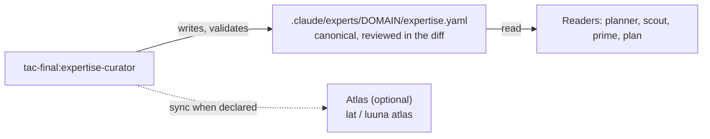

# Optional adapter: Luuna Atlas

tac experts live in `.claude/experts/<domain>/expertise.yaml`. When a project uses the Luuna suite, Atlas can
also hold that expertise as project memory. This file is the adapter contract. Without a declaration, ignore it.

## Declaration

A project opts in with one line in the `## Agentic layer (tac)` section of its `CLAUDE.md`:

```markdown
- Expert adapter: atlas
```

No line, or Atlas not installed (`command -v lat` and `command -v luuna` both fail), means no adapter: the curator
writes the file only and says so in its report.

## Contract

| Rule | Detail |
| --- | --- |
| The file is canonical | Agents always read `.claude/experts/<domain>/expertise.yaml`. Atlas mirrors it; it is never the only copy. |
| One writer | Only `tac-final:expertise-curator` syncs, after it has written and validated the file. |
| Supported CLI only | Sync with `lat` (or `luuna atlas`). Never edit Atlas's managed files directly. |
| Same human gate | The file diff is what the human reviews. Sync after the change is accepted, or report the pending sync. |
| Best-effort | A failed sync is reported (`atlas sync: failed <reason>`) and never fails `improve` or a run. |
| No implied loading | Atlas records are data. Never claim Atlas content reached an agent unless a retrieval actually ran. |
| Drift | If Atlas and the file disagree, the file wins; re-sync from it. |

## Suite boundaries

Each Luuna component is an independently usable CLI; only Atlas is part of this adapter.

| Component | Owns | CLI |
| --- | --- | --- |
| Atlas | Structured expertise and project memory | `luuna atlas` / `lat` |
| Beacon | Reusable prompt templates and versioned instructions | `luuna beacon` / `lbc` |
| Missions | Git-native tickets and structured plans | `luuna missions` / `lms` |
| Luuna runtime | Approvals, scope, execution, review, persistence, publication policy | `luuna` |



Do not claim one component installs another or that a component's text grants authority. Identify the invoked
checkout before attributing behavior to a release, since sibling checkouts and pinned submodules can differ.
