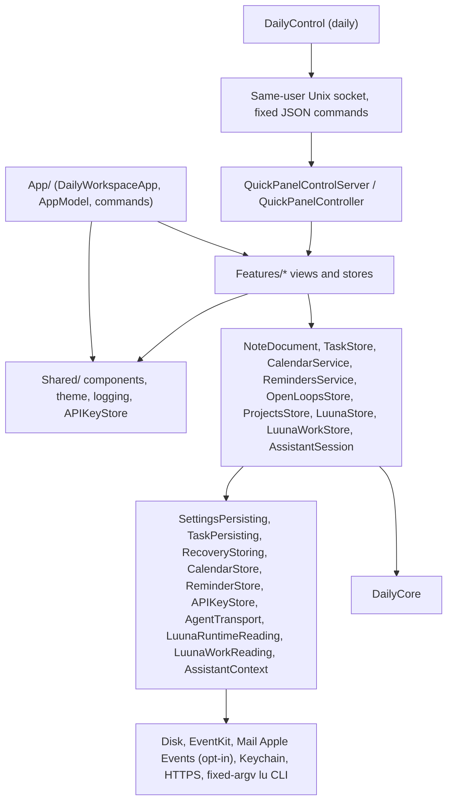

# Architecture

> Implementation inventory, 2026-11-13: Luuna/Missions owns project issues and plans; project Markdown owns context. Org remains external and its app reader has been removed by owner request. Luuna readers use read-only, fixed-argv CLI JSON. T00 B/E approve only path-scoped, reviewed Markdown saves; the owner declined Luuna and automation writes.

Daily Workspace is a Swift package with three code targets and two test targets:

| Target | Kind | Contents |
| --- | --- | --- |
| `DailyCore` | library target (not a product) | Foundation-only caret physics, vault safety and search, project hubs, source observations, native Luuna JSON projections, local tasks, dates and QuickPanel search. |
| `DailyWorkspace` | executable | SwiftUI + AppKit app, feature stores and adapters, QuickPanel and same-user socket service. `Resources/Info.plist` is embedded with a linker flag for EventKit. |
| `DailyControl` (`daily`) | executable | Local control CLI; sends allowlisted JSON panel commands to the app's Unix socket. |
| `DailyCoreTests` | tests | Core logic. |
| `DailyWorkspaceTests` | tests | Stores, adapters and Assistant against fakes and synthetic fixtures. |

## Source tree

```
Sources/DailyCore/
  Caret/          CriticallyDampedSpring, CaretAnimator, CaretPreset (+ CaretEffect)
  Vault/          NoteVault (load/create/save/append, conflict detection, path containment),
                  DailyNoteTemplate (+ DailyNoteSource, DailyNoteResolver), MomentFormat, ObsidianDailyNotes,
                  VaultIndex (search, backlinks; opt-in scoped scan), VaultScope (exclusions before reads)
  Loops/          OpenLoop, LoopAuthority, SourceState, SourceObservation; local tasks,
                  Reminders and opt-in Mail. Historical Org/Seeds/Plot parsers are retired.
  Projects/       ProjectHub, ProjectHubReader (hubs under 01-projects), Frontmatter, MarkdownOutline
  Luuna/          LuunaOrigin (loopback-only), LuunaModels, LuunaObservation, LuunaBoardModels,
                  LuunaRunModels, ProjectAssociation, AssociationRegistry, LuunaHostAccessStore,
                  WorkspaceDirectory+Luuna
  QuickPanel/     QuickPanelSearch
  Storage/        WorkspaceDirectory (~/.config/daily-workspace, legacy adoption), WorkspaceSettings + SettingsPersistence,
                  ShortcutBinding (portable persisted one/two-stroke bindings), RestartLedger (append-only JSONL), WorkspaceDirectory+Ledger
  LocalDay.swift  time-zone-free calendar day

Sources/DailyWorkspace/
  App/            DailyWorkspaceApp, AppModel (+Dependencies, +Sources, +Assistant): composition root,
                  cross-feature actions and observers; AppSection (six screens), AppNavigation, WindowID,
                  AppCommand, CommandRunner, WorkspaceCommands, Preferences, RootView, WorkspaceAppDelegate,
                  KeyboardShortcutCatalog, ShortcutBinding+AppKit, MainWindowShortcutRouter/KeyboardMonitor
  Features/
    Today/          TodayView, TodayDue (+Section), TodayAgendaSection, TodayNotePanel, TodayCapture
    Projects/       ProjectsStore, ProjectsView, ProjectDetailCard, ProjectRepositoriesPanel,
                    ProjectRestartSection, ChipFlow (hub context, associations, restart records)
    OpenLoops/      OpenLoopsStore (local, Reminders, opted-in Mail), MailOpenLoopReader,
                    OpenLoopsView, OpenLoopRow, OpenLoopsFilter, LoopTone, ObservedSource,
                    LoopComposer, OpenLoop+SourceLink
    Notes/          NoteDocument (autosave, external changes, conflicts), RecoveryStore,
                    NotesView, NoteEditorPane, ConflictBanner, SaveStatusLabel, NotePreviewView, BacklinksView
    Notes/Editor/   MarkdownEditor, CaretTextView, CaretPreset+Display
    Search/         SearchView (inside Notes)
    Calendar/       CalendarService (selected-day and week EventKit reads), CalendarStore (+ EventKitCalendarStore),
                    CalendarView, CalendarWeekView (hour grid), CalendarMonthRail (month and day agenda),
                    AgendaList (+ EventRow), EventEditorView
    Assistant/      AssistantSession (+Loop, +Runtime), AnthropicClient and OpenRouterClient (AgentTransport),
                    RetryingAgentTransport, AgentRuntime (limits, run events, deadlines), AgentUsage,
                    AgentStream (+Accumulator), AssistantTools, AssistantToolRunner, AssistantPrompt,
                    WorkspaceAssistantContext, AssistantKey, RestartRecords, RestartPanel,
                    RestartReviewSheet, AssistantView and subviews; cited draft handoff to Notes
    Luuna/          LuunaCLIReader (fixed read-only JSON commands), LuunaRuntimeReading (shared protocol,
                    connection/errors), LuunaStore, LuunaWorkStore, LuunaRunFollower,
                    LuunaProjectPanel, LuunaSettingsView, LuunaStatusWords
    QuickPanel/     QuickPanelController (+rows, keyboard, interactions), QuickPanelControlServer,
                    QuickPanelDataProvider (+Parsing, +Actions), QuickPanelCommandRunner, QuickPanelAttention,
                    QuickPanelCalendar, QuickPanelMusic, QuickPanelSystemActions, QuickPanelIntegrations,
                    QuickPanelPascalSkin (+Details), KittyQuickAccessBorder
    Tasks/          TaskStore, TaskRow, TaskEditSheet (local tasks)
    Reminders/      RemindersService, ReminderStore (+ EventKitReminderStore)
    Capture/        CaptureForm, CaptureMenu, GlobalCaptureShortcut
    CommandPalette/ CommandPaletteView
    Settings/       SettingsView → Vault, Editor, Keyboard, AI, Luuna, Permissions tabs;
                    KeyboardShortcutsSettingsView (searchable bindings and focused key recorder)
  Shared/
    Theme/          ColorTokens, Theme, Typography, BundledFonts, WorkspaceTheme
    Components/     Shared Luuna-style panels, rows, badges, fields and permission states
    Shell/          ShellParts (sidebar and top bar)
    Vault/          VaultSession (security-scoped bookmark), VaultSession+Status
    Logging/        Log (os.Logger channels)
    APIKeyStore.swift Keychain API keys for Assistant and Luuna

Sources/DailyControl/main.swift    same-user panel control client
Resources/                     Info.plist; Fonts/ (Outfit + licenses/provenance), VGA.ttf.base64 (decoded and SHA-256 verified into the generated app as VGA.ttf by scripts/bundle.sh).
```

The visual system follows Luuna's desktop design system (`docs/DESIGN-SYSTEM.md` in the Luuna repository): Mantine's
default-theme colours in light and dark, the system font for text and Outfit for headings, six tones that each pair a
colour with a shape (success, active, danger, attention, neutral, interrupted; green only for verified or authorised
states), hover by background only, and tokens instead of literals.

**Where new code goes:**
- A feature's views, store and service live together under `Features/<Feature>/`.
- Anything used by two or more features goes in `Shared/`.
- Logic that needs no UI or system framework goes in `DailyCore`, with tests.

## Dependencies



Rules:
- Views read stores injected as environment objects (`workspaceEnvironment(_:)` injects all of them) and call store methods. Views never touch disk, EventKit, the Keychain or the network.
- An action that spans features goes through `AppModel`: choosing a vault, opening today's note or another note, and capture. One feature never reaches into another feature's store.
- Menu items, the command palette and toolbar tooltips use `AppCommand` IDs and `KeyboardShortcutCatalog` effective bindings; disabled or rebound keys update all surfaces. The Quick Panel dispatches its configurable route/action keys only while focused, reserving fixed contextual/menu keys, and the main-window monitor resolves non-menu singles/chords without intercepting text editing.
- `DailyCore` imports Foundation only. User-facing wording belongs in the app; the one exception is `VaultError` descriptions.

## State ownership

`AppModel` is created once in `DailyWorkspaceApp` and owns:

| Store | Owns |
| --- | --- |
| `AppNavigation` | selected section, in-window Settings tab, Quick Capture sheet, Command Palette sheet, transient Assistant inspector visibility and shared unsent question |
| `Preferences` | daily-note folder/template, caret preset, preview toggle, Assistant enablement/provider, separate model IDs and runtime limits, recent notes, vault bookmark, persisted shortcut overrides and transient recorder state |
| `VaultSession` | resolving the bookmark, security-scoped access, `VaultSession.State` |
| `NoteDocument` | the open note's URL, text, save state and snapshot; autosave (800 ms debounce); conflict resolution |
| `TaskStore` | `TaskList`, persistence, undo of deletes |
| `OpenLoopsStore` | Local tasks, Reminders and opt-in Mail metadata, each with its own `SourceState`; Mail never flows into Assistant tools. Native Luuna tickets are held separately by `LuunaWorkStore`. Org is not an app source. |
| `ProjectsStore` | Project hubs and app-owned hub/checkout/Luuna associations (`associations.json` only); never treats project Markdown checkboxes as tickets. |
| `LuunaStore` | Read-only CLI health, projects, project details and components; discards old connection responses, preserves last-success observations. |
| `LuunaWorkStore` | Read-only CLI board, tickets, selected ticket, project/global Home, bound-project native run list and selected detail. `LuunaRunFollower` owns the selected run's bounded event stream and stops on selection/connection changes. Run state never changes ticket status; identity and stale-response checks apply to both. |
| `AssistantSession` | in-memory append-only transcript and capped tool loop with runtime limits from `assistantRuntime` (retries, tool deadlines, result budgets, offered tools), content-free run events and per-turn token usage; provider switches discard prior provider transcript; provider-specific transport/key for Anthropic or OpenRouter; optional source-scoped page focus attached only on explicit Ask; reviewed restart-record drafts |
| `CalendarService` | permission status, selected day, that day's events |
| `RemindersService` | permission status, incomplete reminders |

The available content width determines when Projects switches from independently scrolling list and detail columns to one pane, when Calendar moves its month rail into a popover, and when Assistant moves its conversation rail into a popover. Each layout uses the same selection and source stores. Quick Panel pointer and keyboard menus share the command list and dispatch in `QuickPanelControllerMenus.swift`.

The six sidebar screens are **Today** (Calendar, dated local tasks/Reminders, daily note), **Projects** (vault hubs and explicitly bound native Luuna work), **Open Loops** (local tasks/Reminders and opted-in Mail), **Notes** (Markdown editor/search), **Calendar** (EventKit), and **Assistant** (grounded read-only model tools, reviewed restart drafts and user-confirmed note drafts). `QuickPanelController` is a separate reusable panel with a Quick AI Chat action that opens the shared Assistant. It has a read-only Calendar snapshot for today/next event; permission is requested only through user-initiated Settings.

`RootView` owns a per-window sidebar visibility flag. Its top-bar control (⌃⌘S by default) hides the 240 pt sidebar without changing `AppNavigation`; the content column takes the freed width, and Go/⌘1…⌘6 or `G` then T/P/O/N/C/A still select screens. Settings replaces the current content in that same main window; Back returns to its previous section, and the app registers no separate Settings scene. The global capture binding uses Carbon hot-key registration only; recording suspends it temporarily. `AppNavigation.reviewedAssistantNote` keeps a source-cited draft in memory until the user discards it or confirms a conflict-checked save in Notes; the Assistant never owns a save sheet.

`?` toggles a right-side `AssistantInspector` on each workspace screen, with a top-bar button and configurable shortcut; F1 retains the searchable Keyboard reference. At wider window sizes the inspector shares space with the screen, while compact windows overlay the current content without shrinking it. The inspector and full Assistant screen share one session and unsent question. `AssistantPageFocus` is built only when the user sends: Calendar contributes its selected day, Projects its verified selected hub slug, Notes its vault-scope-checked selected path; other pages contribute generic navigation hints. The focus block is labeled metadata rather than evidence and is never sent on navigation or opening the panel. The existing read-only tools verify claims and cite owner records; excluded vault paths and Mail do not enter this context.

`AppModel` also observes:
- midnight and time-zone changes (to re-evaluate "today")
- app activation (to check for external note changes and reload Calendar and Reminders)
- a 2-second poll for external changes to the open note
- Reduce Motion

### Durability contract

- `NoteDocument` never discards a version of a note without first writing it to the recovery folder. If that write fails, the conflict stays open.
- `NoteDocument.append` and `TaskStore.add` report success only after the data is on disk. A failure rolls the change back, so retrying cannot create duplicates. Capture relies on this, so the capture form only closes after a durable save.

## Protocol boundaries

| Protocol | Production | Test fake |
| --- | --- | --- |
| `SettingsPersisting` | `SettingsPersistence` (DailyCore) | `InMemorySettings` |
| `TaskPersisting` | `TaskPersistence` (DailyCore) | `InMemoryTaskPersistence` |
| `RecoveryStoring` | `RecoveryStore` | `FakeRecovery` |
| `CalendarStore` | `EventKitCalendarStore` | `FakeCalendarStore` |
| `ReminderStore` | `EventKitReminderStore` | `FakeReminderStore` |
| `APIKeyStore` | `KeychainAPIKeyStore` | `FakeKeyStore` |
| `AgentTransport` | `AnthropicClient` or `OpenRouterClient` (Messages-format streaming) | `FakeAgentTransport` |
| `AssistantContext` | `WorkspaceAssistantContext` (read-only over the stores and the vault) | fake contexts in tests |
| `LuunaRuntimeReading` | `LuunaCLIReader` (`health`, `projects`, `project`, `components` as fixed `lu … --json` arguments) | `FakeLuunaReader` |
| `LuunaWorkReading` | `LuunaCLIReader` (`board`, `tickets`, `show-ticket`, project/global `home`, `runs --project`, `run <id>` as fixed `lu … --json` arguments) | `FakeLuunaWorkReader` |
| `LuunaRunFollowing` | `LuunaCLIReader` (`follow <run> --after <sequence> --json` with incremental stdout) | scripted follow fakes |
| `MailResponseSource` | fixed AppleScript over Mail metadata after opt-in (no bodies or headers) | fake Mail response source |

Production instances are wired in `AppModel.Dependencies.live`. `AppModel.Dependencies.test(...)` and fakes live in `Tests/DailyWorkspaceTests/`; the vault itself uses real temporary directories to exercise file-safety behaviour. The Luuna reader uses absolute `~/.local/bin/lu`, validated loopback origin and a Keychain token passed in the child environment, not argv. Every read sets `LUUNA_NO_AUTO_START=1`; the installed local launcher honors it by refusing stopped runtimes without starting/building them. This launcher behavior is a required deployment contract, not guaranteed by a different installation of `lu`. Unknown native JSON keys and native ticket status are retained; failures, stale observations and empty successful reads stay distinct. `LuunaRuntimeReading.swift` retains the shared protocol/connection/error declarations, not an HTTP transport; the HTTP client and Seeds/Plot project parsers are removed.

Native run reads use a 10-second, 2 MiB combined-output process-group runner; cancellation kills the process group. For a selected run, `LuunaRunFollower` consumes incremental stdout with ordered backpressure, parses complete NDJSON records, rejects foreign run/project IDs, retains at most 500 events and 2 MiB of recent input, and resumes after a broken connection using the last complete sequence. The CLI's fixed error shape classifies unauthorized and refused reads; partial data is never treated as an empty source. Assistant and Quick Panel Agents show these read-only events without sending them to Anthropic. No session start, cancel, external write or ticket-closure adapter is enabled.

## Persistence

| Data | Location |
| --- | --- |
| Notes | The user's vault, as plain Markdown, opened through a security-scoped bookmark |
| App folder | `~/.config/daily-workspace/` (`WorkspaceDirectory`), created `0700`. Always under the home folder; `$XDG_CONFIG_HOME` is not honored because Dock-launched apps don't see shell variables. |
| Settings and recent notes | `settings.json` in the app folder: pretty-printed JSON, safe to edit by hand while the app is closed. Missing keys use defaults, unknown keys are ignored, a corrupt file is moved aside, and an unreadable file is never overwritten. Shortcut overrides live here, are validated on load and never contain credentials; the transient recorder flag is not persisted. On the first launch without it, the earlier UserDefaults values (`Preferences.LegacyKey`) are imported once. |
| Tasks | `tasks.json` in the app folder. A corrupt file is moved aside, never silently overwritten. On the first launch without it, `~/Library/Application Support/DailyWorkspace/tasks.json` is copied over; the original is left in place. |
| Discarded conflict versions | `recovery/` in the app folder |
| Restart records | `restart-ledger.jsonl` in the app folder: append-only; a corrupt line is skipped and reported, never rewritten |
| Project associations | `associations.json` in the app folder (hub ↔ checkouts ↔ optional Luuna project); `luuna-host.json` holds the runtime origin only |
| Keys and tokens | Keychain: `app.dailyworkspace.anthropic`, `app.dailyworkspace.openrouter` (separate Assistant API keys), `app.dailyworkspace.luuna` (Luuna runtime token); access through `Shared/APIKeyStore.swift` |
| Read, never written | `.obsidian/daily-notes.json` and the daily-note template inside the vault; Org files are external to this app and never read or written |

Live startup reads Luuna and the selected Assistant provider credential off the main actor; switching providers invalidates any pending Assistant key read. An explicit connection or key save invalidates pending results so old credentials cannot overwrite them. Tests keep synchronous in-memory key reads.

External Mail subjects/IDs are ephemeral, read only after Settings opt-in, discarded on opt-out or failed permission recheck, and never sent to Assistant tools. QuickPanel config is `quick-panel.json` under the app folder; its Unix socket and lock live under `~/Library/Caches/DailyWorkspace/` with private directory/socket permissions and same-user peer checks. The `daily` client can send only panel lifecycle/notification commands, not tools, paths or arbitrary shell commands. QuickPanel clipboard-count feedback and Kitty border tracking are opt-in; the generated app includes a SHA-256-verified VGA font registered once by `BundledFonts.vgaName`, with a font fallback outside the bundle or when registration fails. Visual parity has not been verified here.

**Authority:** On 2026-11-13 the owner approved T00 B for a reviewed append to the existing Quick Notes file or a named new `00-inbox/*.md`, and E for source-cited Assistant drafts saved through a separate user-selected, full before/after preview. `VaultNoteReview` rejects excluded paths, root targets, missing parents, stale bookmarks and changed snapshots; `NoteDocument` owns the same-file save when open. Model tools remain read-only. Org is entirely outside the app; Luuna writes, run cancellation, app-owned automations and saved transcripts were declined. Existing daily-note saves, local tasks, EventKit actions and app-owned restart records retain their separate contracts.

## Logging

`Log` (in `Shared/Logging/Log.swift`) has one `os.Logger` channel per category: `app`, `vault`, `notes`, `tasks`, `capture`, `calendar`, `reminders`, `chat`, `luuna`. All use the subsystem `app.dailyworkspace.mac`. Stream them with `./scripts/build_and_run.sh --app-logs`.

Logs never contain note text, chat content or credentials. Paths are logged `.private`. Errors are logged as a public, path-free `Log.code(error)` (domain#code) plus a `.private(mask: .hash)` description, because Cocoa error messages embed file names.
