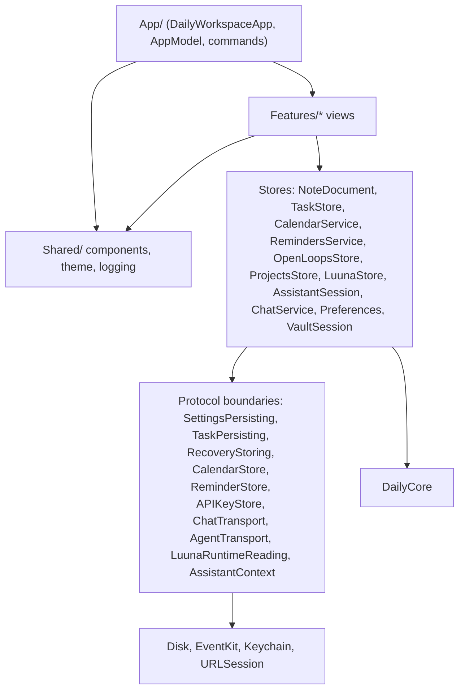

# Architecture

Daily Workspace is a Swift package with two code targets and two test targets:

| Target | Kind | Contents |
| --- | --- | --- |
| `DailyCore` | library target (not a product) | Pure Foundation logic: caret physics, the vault file layer, the daily-note template, the search index, tasks, `LocalDay`. No UI and no system frameworks. |
| `DailyWorkspace` | executable | The SwiftUI + AppKit app: stores, services, views. `Resources/Info.plist` is embedded with a linker flag so EventKit usage strings exist even under `swift run`. |
| `DailyCoreTests` | tests | Core logic. |
| `DailyWorkspaceTests` | tests | Store behaviour against fakes, via `@testable import DailyWorkspace`. |

## Source tree

```
Sources/DailyCore/
  Caret/          CriticallyDampedSpring, CaretAnimator, CaretPreset (+ CaretEffect)
  Vault/          NoteVault (load/create/save/append, conflict detection, path containment),
                  DailyNoteTemplate (+ DailyNoteSource, DailyNoteResolver), MomentFormat, ObsidianDailyNotes,
                  VaultIndex (search, backlinks; opt-in scoped scan), VaultScope (exclusions before reads)
  Loops/          OpenLoop, LoopAuthority, SourceState, SourceObservation; read-only OrgReader (+ OrgSyntax),
                  SeedsReader, PlotReader; JSONValue (unknown fields kept)
  Projects/       ProjectHub, ProjectHubReader (hubs under 01-projects), Frontmatter, MarkdownOutline
  Luuna/          LuunaOrigin (loopback-only), LuunaModels, LuunaObservation, ProjectAssociation, AssociationRegistry,
                  LuunaHostAccessStore, WorkspaceDirectory+Luuna
  Tasks/          TaskList (TaskItem transitions), TaskPersistence (JSON file)
  Storage/        WorkspaceDirectory (~/.config/daily-workspace, legacy adoption), WorkspaceSettings + SettingsPersistence,
                  RestartLedger (append-only JSONL), WorkspaceDirectory+Ledger
  LocalDay.swift  time-zone-free calendar day

Sources/DailyWorkspace/
  App/            DailyWorkspaceApp     scenes; the composition root; registers the bundled Outfit font
                  AppModel (+Dependencies, +Sources, +Assistant)  owns every store; actions that span features; observers
                  AppSection            the six screens: titles, descriptions, symbols, ⌘1…⌘6; AppNavigation, WindowID
                  AppCommand            command registry, CommandRunner, WorkspaceCommands (menu bar)
                  Preferences           every remembered setting (settings.json), legacy UserDefaults import
                  RootView, WorkspaceAppDelegate
  Features/
    Today/          TodayView, TodayDue (+Section), TodayAgendaSection, TodayNotePanel, TodayCapture
    Projects/       ProjectsStore, ProjectsView (rail + ProjectDetailCard), ProjectRepositoriesPanel, ProjectWorkPanels,
                    ProjectRestartSection
    OpenLoops/      OpenLoopsStore (read-only federation), OpenLoopsView, OpenLoopRow, OpenLoopsFilter, LoopTone,
                    ObservedSource, LoopComposer, OpenLoop+SourceLink
    Notes/          NoteDocument (open note: autosave, external changes, conflicts), RecoveryStore,
                    NotesView, NoteEditorPane, ConflictBanner, SaveStatusLabel, NotePreviewView, BacklinksView
    Notes/Editor/   MarkdownEditor, CaretTextView, CaretPreset+Display (user-facing preset names)
    Search/         SearchView (shown inside Notes)
    Calendar/       CalendarService (owns the selected day), CalendarStore (+ EventKitCalendarStore),
                    CalendarView, AgendaList (+ EventRow), EventEditorView
    Assistant/      AssistantSession (+Loop; append-only transcript, tool loop), AnthropicClient (AgentTransport),
                    AgentStream (+Accumulator; SSE), AssistantTools, AssistantToolRunner, AssistantPrompt,
                    WorkspaceAssistantContext (+ VaultReadPolicy; read-only tools over the stores and the vault),
                    AssistantKey, RestartRecords, RestartPanel, RestartReviewSheet,
                    AssistantView, AssistantRail, AssistantTranscript, ToolCallsView, AssistantComposer
    Luuna/          LuunaRuntimeClient (LuunaRuntimeReading), LuunaStore, LuunaProjectPanel, LuunaSettingsView,
                    LuunaStatusWords
    Tasks/          TaskStore, TaskRow, TaskEditSheet (local tasks; shown in Today and Open Loops)
    Reminders/      RemindersService, ReminderStore (+ EventKitReminderStore) (shown in Open Loops)
    Chat/           APIKeyStore (KeychainAPIKeyStore, used by every key); ChatService, OpenRouterClient and ChatView
                    are the old OpenRouter chat, no longer reachable from the UI and due for removal
    Capture/        CaptureForm (sheet + window), CaptureMenu (menu-bar extra), GlobalCaptureShortcut
    CommandPalette/ CommandPaletteView
    Settings/       SettingsView → Vault, Editor, AI, Luuna, Permissions tabs
  Shared/
    Theme/          ColorTokens (Luuna/Mantine roles, light + dark), Theme, Typography (TextRole), BundledFonts,
                    WorkspaceTheme (legacy names)
    Components/     The Luuna component library in SwiftUI: Tone/ToneMark/StatusBadge/Tag, Page/PageHeader, Panel,
                    Records, Stats, Facts, Feedback (Callout, ReasonNote, EmptyState), Buttons, Fields, FormFields,
                    SettingsRow, ShortId, StreamingDots, PermissionEmptyState, BoxedTextField, InfoBanner, NoteLabel, PermissionPrompt,
                    VaultStatusView
    Shell/          ShellParts (240 pt sidebar, 56 pt top bar with the Go to… ⌘K trigger)
    Vault/          VaultSession (security-scoped bookmark → NoteVault), VaultSession+Status
    Logging/        Log (os.Logger channels)

Resources/        Info.plist (usage strings, ATSApplicationFontsPath), Fonts/ (Outfit woff2 + OFL.txt)
```

The visual system follows Luuna's desktop design system (`docs/DESIGN-SYSTEM.md` in the Luuna repository): Mantine's
default-theme colours in light and dark, the system font for text and Outfit for headings, six tones that each pair a
colour with a shape (success, active, danger, attention, neutral, interrupted; green only for verified or authorised
states), hover by background only, and tokens instead of literals.

**Where new code goes:**
- A feature's views, store and service live together under `Features/<Feature>/`.
- Anything used by two or more features goes in `Shared/`.
- Logic that needs no UI or system framework goes in `DailyCore`, with tests.

## Dependencies



Rules:
- Views read stores injected as environment objects (`workspaceEnvironment(_:)` injects all of them) and call store methods. Views never touch disk, EventKit, the Keychain or the network.
- An action that spans features goes through `AppModel`: choosing a vault, opening today's note or another note, and capture. One feature never reaches into another feature's store.
- Menu items, the command palette and toolbar tooltips are all built from `AppCommand` and `AppSection`, so their titles and shortcuts cannot drift apart.
- `DailyCore` imports Foundation only. User-facing wording belongs in the app; the one exception is `VaultError` descriptions.

## State ownership

`AppModel` is created once in `DailyWorkspaceApp` and owns:

| Store | Owns |
| --- | --- |
| `AppNavigation` | selected section, Quick Capture sheet, Command Palette sheet |
| `Preferences` | daily-note folder/template, caret preset, preview toggle, OpenRouter model, recent notes, vault bookmark |
| `VaultSession` | resolving the bookmark, security-scoped access, `VaultSession.State` |
| `NoteDocument` | the open note's URL, text, save state and snapshot; autosave (800 ms debounce); conflict resolution |
| `TaskStore` | `TaskList`, persistence, undo of deletes |
| `OpenLoopsStore` | read-only observations per owner (Org, Seeds, Plot, local tasks, Reminders), each with its `SourceState`; queries for a day, overdue and counts |
| `ProjectsStore` | project hubs, the selected project's Seeds issues, Plot records and association; association edits (only `associations.json`) |
| `LuunaStore` | the loopback connection, a session generation that discards stale responses, last-success observations |
| `AssistantSession` | the append-only transcript, the tool loop and its caps, restart-record drafts |
| `CalendarService` | permission status, selected day, that day's events |
| `RemindersService` | permission status, incomplete reminders |
| `ChatService` | in-memory transcript, request lifecycle, whether a key is saved |

`AppModel` also observes:
- midnight and time-zone changes (to re-evaluate "today")
- app activation (to check for external note changes and reload Calendar and Reminders)
- a 2-second poll for external changes to the open note
- Reduce Motion

### Durability contract

- `NoteDocument` never discards a version of a note without first writing it to the recovery folder. If that write fails, the conflict stays open.
- `NoteDocument.append` and `TaskStore.add` report success only after the data is on disk. A failure rolls the change back, so retrying cannot create duplicates. Capture relies on this, so the capture form only closes after a durable save.

## Protocol boundaries

| Protocol | Production | Test fake |
| --- | --- | --- |
| `SettingsPersisting` | `SettingsPersistence` (DailyCore) | `InMemorySettings` |
| `TaskPersisting` | `TaskPersistence` (DailyCore) | `InMemoryTaskPersistence` |
| `RecoveryStoring` | `RecoveryStore` | `FakeRecovery` |
| `CalendarStore` | `EventKitCalendarStore` | `FakeCalendarStore` |
| `ReminderStore` | `EventKitReminderStore` | `FakeReminderStore` |
| `APIKeyStore` | `KeychainAPIKeyStore` | `FakeKeyStore` |
| `ChatTransport` | `OpenRouterClient` | `FakeTransport` |
| `AgentTransport` | `AnthropicClient` | `FakeAgentTransport` |
| `AssistantContext` | `WorkspaceAssistantContext` (read-only over the stores and the vault) | fake contexts in tests |
| `LuunaRuntimeReading` | `LuunaRuntimeClient` | `FakeLuunaReader` |

Production instances are wired in `AppModel.Dependencies.live`. The fakes, and `AppModel.Dependencies.test(...)` (in-memory settings, a fresh temporary app folder per call, fake EventKit, Keychain, network and Luuna, no legacy import, no system observers), live in `Tests/DailyWorkspaceTests/Fakes.swift`. The vault itself is not faked: tests use real temporary directories, because the file-safety behaviour is exactly what needs testing.

## Persistence

| Data | Location |
| --- | --- |
| Notes | The user's vault, as plain Markdown, opened through a security-scoped bookmark |
| App folder | `~/.config/daily-workspace/` (`WorkspaceDirectory`), created `0700`. Always under the home folder; `$XDG_CONFIG_HOME` is not honored because Dock-launched apps don't see shell variables. |
| Settings and recent notes | `settings.json` in the app folder: pretty-printed JSON, safe to edit by hand while the app is closed. Missing keys use defaults, unknown keys are ignored, a corrupt file is moved aside, and an unreadable file is never overwritten. On the first launch without it, the earlier UserDefaults values (`Preferences.LegacyKey`) are imported once. |
| Tasks | `tasks.json` in the app folder. A corrupt file is moved aside, never silently overwritten. On the first launch without it, `~/Library/Application Support/DailyWorkspace/tasks.json` is copied over; the original is left in place. |
| Discarded conflict versions | `recovery/` in the app folder |
| Restart records | `restart-ledger.jsonl` in the app folder: append-only; a corrupt line is skipped and reported, never rewritten |
| Project associations | `associations.json` in the app folder (hub ↔ checkouts ↔ optional Luuna project); `luuna-host.json` holds the runtime origin only |
| Keys and tokens | Keychain: `app.dailyworkspace.anthropic` (Assistant), `app.dailyworkspace.luuna` (Luuna runtime token), `app.dailyworkspace.openrouter` (plain chat) |
| Read, never written | Org files, `.seeds/`, `.plot/`, `.obsidian/daily-notes.json` and the daily-note template, all inside the vault |

## Logging

`Log` (in `Shared/Logging/Log.swift`) has one `os.Logger` channel per category: `app`, `vault`, `notes`, `tasks`, `capture`, `calendar`, `reminders`, `chat`, `luuna`. All use the subsystem `app.dailyworkspace.mac`. Stream them with `./scripts/build_and_run.sh --app-logs`.

Logs never contain note text, chat content or credentials. Paths are logged `.private`. Errors are logged as a public, path-free `Log.code(error)` (domain#code) plus a `.private(mask: .hash)` description, because Cocoa error messages embed file names.
